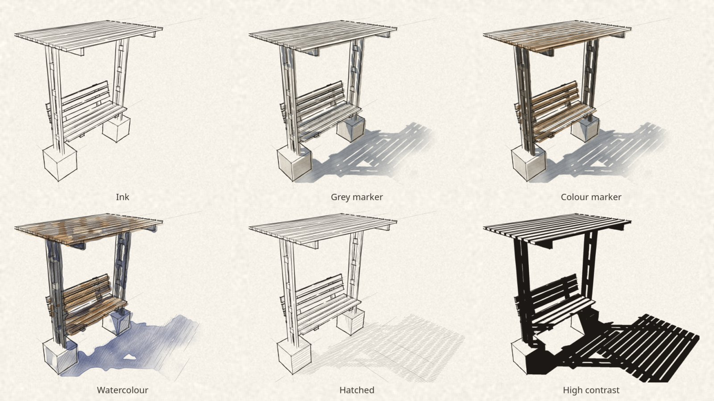
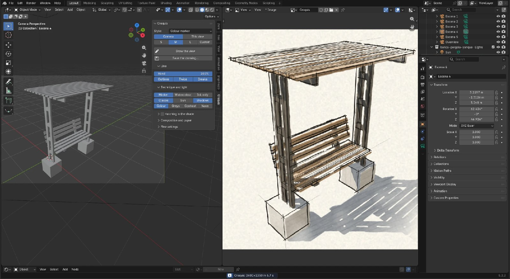

# Croquis for Blender

**[English](#english) · [Español](#español) · [Português](#português)**

A Blender extension that draws the camera's view as an architect's
**freehand sketch on paper**: ink lines that run past the corners and waver
with the hand, grey or colour marker, watercolour, hatching or
high-contrast ink, on the paper you choose. No nodes, no setup: pick a
style and press a button.



---

## English

### What it does

- **Six ready-made styles:** Ink, Grey marker, Colour marker, Watercolour,
  Hatched and High contrast. Change anything and it becomes *Custom*.
- **The line of a hand:** strokes that overshoot at real corners, bow and
  waver, sometimes drawn twice, with the outlines heavier. From *Ruler* to
  *Loose*.
- **From your scene:** the scene's camera (at the render's shape) or the 3D
  view; each material in the nearest of a box of twenty markers, from its
  Principled BSDF base colour or the average of its image, or in greys, or
  in high contrast; a classic sketcher's light or your Sun lamp, with cast
  shadows on the model and the ground.
- **The edges a hand draws:** where faces meet at a real angle, sharp edges
  and borders; smooth surfaces by their silhouette. Pictures on a sheet (2D
  people and trees with an image's transparency) are left out.
- **Paper:** cream, white, kraft, toned grey, tracing, squared, dotted, or
  an image of your own.
- **Output:** S, M, L or a width of your own; PNG, **SVG in layers** (paper,
  colour, and the ink as editable vector paths) or PDF.
- **Large scenes:** fine detail is simplified as a hand would; a scene of
  1.7 million triangles draws in about 40 seconds.



### Install

In Blender, **Edit ▸ Preferences ▸ Get Extensions**, look for *Croquis*.
Or download `croquis-blender-<version>.zip` from
[Releases](https://github.com/vicc3d/croquis-blender/releases) and use
**Install from Disk…** in the same place. Needs Blender 5.0 or later.

### Use

Press **N** in the 3D viewport and open the **Croquis** tab. Choose a style,
draw from the **Camera** or from **This view**, pick a size and press
**Draw the view**: the drawing opens in an image editor. **Save the
drawing…** writes it as PNG, SVG in layers or PDF.

The panel speaks English, Spanish and Portuguese, following Blender's
interface language.

### Development

The drawing core is shared with
[IngeTrazo Croquis](https://github.com/vicc3d/ingetrazo-croquis), the same
extension for the IngeTrazo modeler, where it is written and tested. It is
copied into `croquis_blender/core/` by `tools/sync_core.py`; change it
there.

```bash
python3 tools/sync_core.py ../ingetrazo-croquis     # the core, when it improves
python3 tools/build.py --blender /path/to/blender   # build/croquis-blender-<version>.zip
blender -b --factory-startup --python tests/check_draw.py -- /tmp/croquis
blender -b --factory-startup --python tests/check_i18n.py
```

---

## Español

Una extensión de Blender que dibuja la vista de la cámara como un **croquis
de arquitecto a mano alzada sobre papel**: líneas de tinta que sobresalen en
las esquinas y tiemblan con la mano, rotulador gris o de color, acuarela,
rayado o tinta de alto contraste, sobre el papel que elijas. Sin nodos ni
configuración: eliges un estilo y pulsas un botón.

### Qué hace

- **Seis estilos listos:** Tinta, Rotulador gris, Rotulador color,
  Acuarela, Rayado y Alto contraste. Si cambias algo, pasa a
  *Personalizado*.
- **La línea de una mano:** trazos que sobresalen en las esquinas de
  verdad, se curvan y tiemblan, a veces repasados, con las siluetas más
  marcadas. Desde *Regla* hasta *Suelta*.
- **Desde tu escena:** la cámara de la escena (con la forma del render) o
  la vista 3D; cada material con el rotulador más cercano de una caja de
  veinte, a partir del color base del Principled BSDF o del promedio de su
  imagen, o en grises, o en alto contraste; una luz clásica de croquis o tu
  lámpara Sun, con sombras sobre el modelo y el suelo.
- **Las aristas que dibuja una mano:** donde las caras forman un ángulo
  real, las marcadas como *sharp* y los bordes; las superficies curvas por
  su silueta. Las imágenes sobre un plano (personas y árboles 2D con
  transparencia) se dejan fuera.
- **Papel:** crema, blanco, kraft, gris, calco, cuadriculado, punteado o
  una imagen tuya.
- **Salida:** S, M, L o un ancho a tu medida; PNG, **SVG por capas**
  (papel, color y la tinta en trazos vectoriales editables) o PDF.
- **Escenas grandes:** el detalle fino se simplifica como lo haría una
  mano; una escena de 1,7 millones de triángulos se dibuja en unos 40
  segundos.

### Instalar

En Blender, **Edit ▸ Preferences ▸ Get Extensions**, busca *Croquis*. O
descarga `croquis-blender-<versión>.zip` desde
[Releases](https://github.com/vicc3d/croquis-blender/releases) y usa
**Install from Disk…** en el mismo lugar. Necesita Blender 5.0 o
posterior.

### Uso

Pulsa **N** en la vista 3D y abre la pestaña **Croquis**. Elige un estilo,
dibuja desde la **Cámara** o desde **Esta vista**, elige el tamaño y pulsa
**Dibujar la vista**: el dibujo se abre en un editor de imagen. **Guardar
el dibujo…** lo guarda en PNG, SVG por capas o PDF.

El panel está en inglés, español y portugués, según el idioma de la
interfaz de Blender.

---

## Português

Uma extensão do Blender que desenha a vista da câmera como um **croqui de
arquiteto à mão livre sobre papel**: linhas de nanquim que passam dos
cantos e tremem com a mão, marcador cinza ou colorido, aquarela, hachura ou
nanquim de alto contraste, no papel que você escolher. Sem nós nem
configuração: escolha um estilo e clique num botão.

### O que faz

- **Seis estilos prontos:** Tinta, Marcador cinza, Marcador colorido,
  Aquarela, Hachurado e Alto contraste. Se você mudar algo, passa a
  *Personalizado*.
- **A linha de uma mão:** traços que passam dos cantos de verdade, se
  curvam e tremem, às vezes repassados, com as silhuetas mais marcadas. De
  *Régua* a *Solta*.
- **A partir da sua cena:** a câmera da cena (com a forma do render) ou a
  vista 3D; cada material com o marcador mais próximo de uma caixa de
  vinte, a partir da cor base do Principled BSDF ou da média da sua imagem,
  ou em cinzas, ou em alto contraste; uma luz clássica de croqui ou sua
  lâmpada Sun, com sombras no modelo e no chão.
- **As arestas que uma mão desenha:** onde as faces formam um ângulo real,
  as marcadas como *sharp* e as bordas; as superfícies curvas pela
  silhueta. Imagens sobre um plano (pessoas e árvores 2D com
  transparência) ficam de fora.
- **Papel:** creme, branco, kraft, cinza, vegetal, quadriculado,
  pontilhado ou uma imagem sua.
- **Saída:** S, M, L ou uma largura sob medida; PNG, **SVG em camadas**
  (papel, cor e o nanquim em traços vetoriais editáveis) ou PDF.
- **Cenas grandes:** o detalhe fino é simplificado como faria uma mão; uma
  cena de 1,7 milhão de triângulos é desenhada em uns 40 segundos.

### Instalar

No Blender, **Edit ▸ Preferences ▸ Get Extensions**, procure *Croquis*. Ou
baixe `croquis-blender-<versão>.zip` em
[Releases](https://github.com/vicc3d/croquis-blender/releases) e use
**Install from Disk…** no mesmo lugar. Precisa do Blender 5.0 ou
posterior.

### Uso

Pressione **N** na vista 3D e abra a aba **Croquis**. Escolha um estilo,
desenhe a partir da **Câmera** ou de **Esta vista**, escolha o tamanho e
clique em **Desenhar a vista**: o desenho abre num editor de imagem.
**Salvar o desenho…** salva em PNG, SVG em camadas ou PDF.

O painel fala inglês, espanhol e português, conforme o idioma da interface
do Blender.

---

## Support · Apoyo · Apoio

Croquis is free. If it is useful to you, you can buy me a coffee on
[Ko-fi](https://ko-fi.com/vicc3d). · Croquis es gratis; si te sirve, puedes
invitarme un café en [Ko-fi](https://ko-fi.com/vicc3d). · O Croquis é
gratuito; se for útil, você pode me pagar um café no
[Ko-fi](https://ko-fi.com/vicc3d).

## Credits · Créditos

**Concept, UX/UI & Design:** [Victor Crespo](https://3dvic.com)

The images show the Yanque plaza models that come with
[IngeTrazo](https://github.com/ingelibre/ingetrazo), by Marco Sumari Tellez,
[CC BY 4.0](https://creativecommons.org/licenses/by/4.0/), brought into
Blender with [IngeTrazo Sync](https://extensions.blender.org/add-ons/ingetrazo-io/).

Independent extension, not made by, affiliated with or endorsed by the
Blender Foundation. Blender is a trademark of the Blender Foundation. ·
Extensión independiente, sin relación con la Blender Foundation. · Extensão
independente, sem relação com a Blender Foundation.

License · Licencia · Licença: GPL-3.0-or-later.
